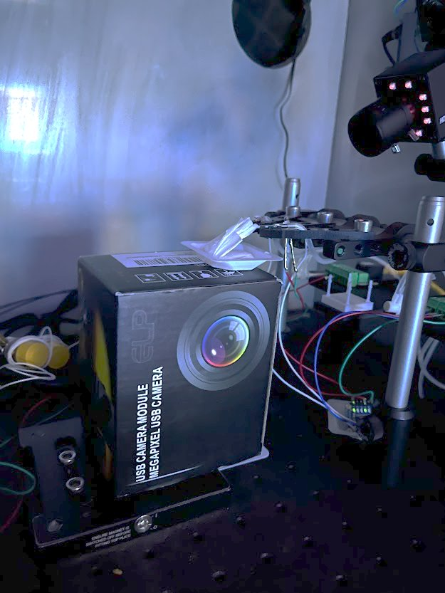

# The rigs

What is on the rigs in room 311, how to set up a rig PC, calibration, and what to do when something stops working. Ports and calibration values are in `Params/Rigs.csv`, described in [PARAMETERS.md](PARAMETERS.md#rig-settings-paramsrigscsv). For anything not covered here, ask Quentin Pajot-Moric (see the README, [Contacts](README.md#contacts)).

## What each rig has

Every rig has:
- a PC in the room, with one account; the password is the user name. The repository is at `C:\Users\MouseRoom\Desktop\BehaviourRig`;
- a Harp sound card and a speaker;
- two lick spouts, each with a touch sensor and a water valve, fed from a 20 ml syringe. Each sensor has a light that comes on when the spout is touched;
- a board for the sensors and valves: a Harp behaviour board or an Arduino Nano;
- a camera.

Left and right always mean the mouse's left and right; valve 1 is the left spout and valve 2 the right. The rigs are numbered 31101–31109; older notes, including the lab's protocols, call them rigs 1–9.

| Rig | Sensors and valves | Optogenetics | Status (October 2026) |
|---|---|---|---|
| 31101 | Harp behaviour board | fibre, with masking light | in use |
| 31102 | Harp behaviour board | fibre, with masking light | in use |
| 31103 | Harp behaviour board | none | has a problem; not in `Rigs.csv` |
| 31104 | Arduino | none | in use |
| 31105 | Arduino | none yet: Zapit is planned and the equipment is ready | in use |
| 31106 | Arduino | none | not working; not in `Rigs.csv` |
| 31107 | Arduino | none | in use |
| 31108 | Arduino | Zapit, with masking light | in use |
| 31109 | Arduino | none | in use |

The masking light, and the fibre light on 31101 and 31102, are driven by a second Arduino (an Arduino Mega); Zapit takes its commands from the task workflow directly. Only the opto rigs have a masking light, so only they can run masking sessions. The masking light needs no settings.

Everything stays switched on; there is no start-up order.

## The spouts

The spouts sit on a mover (Thorlabs) with knobs for fine adjustment. Set them slightly below the mouse's mouth, the same distance from both sides, so it can reach and lick both. Touching a spout turns on its sensor light, which is the quickest way to check that a sensor works.

## Water

Use regular water. Fill the syringe to the top (20 ml) every morning and keep it above 15 ml: the valves are calibrated with a full syringe, and the reward gets smaller as the level drops.

If air stays in the tubes, keep flushing until it is gone, with Flush Rig or, on the Harp rigs, by hand in the Harp Behaviour app (below).

When and how to change the tubing or a valve, and where spares and tools are kept, isn't written down yet: ask Quentin.

## COM ports

Each board appears in Windows as a COM port, and the ports are recorded in the rig's row of `Params/Rigs.csv`. The numbers can change when a USB cable or hub is swapped (not when the PC restarts), and Bonsai then won't start. Find the new ports in Windows Device Manager or the Harp Behaviour app, update `Rigs.csv` in the repository, and push.

## The Harp Behaviour app

The rigs with a Harp behaviour board (31101, 31102) have the **Harp Behaviour** app on the desktop. Open it and connect to the board's COM port (`Harp_Beh_Port` in `Rigs.csv`). Close it again before launching a session or Flush Rig: only one program can use the port at a time.

**When the valves don't open.** Sometimes the board switches its outputs to pulse mode by itself; why is not known. The valves then open and close at once, so little or no water comes out, during Flush Rig or a session. To fix it, go to the **Output pulse** tab and set **Use pulse** to false for the rows Port 0/1/2 12 V and Poke 0/1/2 Valve (ms).

**Opening the valves by hand.** On the **Interface** tab, tick Port 1 and Port 2 (the 12 V outputs) and send; untick them and send again to close the valves. This is also a way to flush by hand.

## Setting up a rig PC (once)

1. **Bonsai 2.7** installed for the Windows user, so that `%LOCALAPPDATA%\Bonsai\Bonsai.exe` exists. It needs these packages:
   - Bonsai.Core, Bonsai.System, Bonsai.Design.Visualizers
   - Bonsai.Scripting.Expressions, Bonsai.Scripting.IronPython
   - Bonsai.Numerics, Bonsai.Dsp, Bonsai.Vision, Bonsai.Osc, Bonsai.Windows.Input, Bonsai.Shaders
   - Bonsai.Harp, Bonsai.Harp.CF
   - BonVision

   This list is taken from the workflow file's namespace declarations. Opening the workflow once in the editor shows any that are missing.
2. **Miniconda or Anaconda** in the user folder (`%USERPROFILE%\miniconda3` or `anaconda3`; the launcher looks there). Then run `conda env create -f GUI/GUI_env.yml` to create `gui_env`.
3. **Git** on the PATH, and the repository cloned to `C:\Users\MouseRoom\Desktop\BehaviourRig`.
4. **Register the rig.**
   - Add a row to `Params/Rigs.csv`, with the PC's Windows computer name in `Hostname`, then commit and push.
   - On the PC, create `C:\ProgramData\MouseRoom\rig.json` containing `{"rig": "<id>"}`.
5. **A desktop shortcut** to `GUI\Launch_Bonsai_GUI.bat`.
6. **Check.** Start the panel; the bottom line should read `Rig <id>   (<computer name>)` in green.

## Calibration

Water calibration sets each valve's opening time (`Left_Valve_Time`, `Right_Valve_Time`); sound calibration sets `Speaker_Slope` and `Speaker_Y_Intercept`. New values go into the rig's row of `Params/Rigs.csv`, in the repository on your own computer: run the tests, commit and push, and the rig picks them up the next time its launcher starts. The rig's own `Params\Rig_Params.csv`, which older notes call `rig_params`, is rewritten from `Rigs.csv` every time the panel starts, so editing it has no lasting effect.

The calibration workflows still point at an old port and an old location, so each needs one setting changed in the editor before you run it (below). The launcher resets the repository the next time it starts, which undoes these edits, so you make them each time.

### Water

The aim is 5 µl per opening, from each spout.

**When.** Check every week. Once a rig has stayed the same for a couple of weeks, checking once a month is enough. Check again after anything changes on the water side, such as tubing, a valve or the spouts, and recalibrate only when a check is off.

**You need** a high-precision scale (not the one for weighing mice), a weighing dish, a Kimwipe, and an empty camera box or anything about 20 cm tall with a flat top.

**Checking, with the Calibrate button.** Flush the rig and fill the syringe to 20 ml. Then press **Calibrate** on the Setup tab of the panel and follow the window:
1. It shows the rig's `Left_Valve_Time` and `Right_Valve_Time` from `Rigs.csv`. Press Start.
2. For each run it asks you to set up the dish: fold a Kimwipe into a shape that stays put between the two spouts, put it on the weighing dish, zero the scale with both on it, and put the dish on the box with the Kimwipe touching the spouts so it catches all the water:

   

3. Press Run. The valve opens 200 times, once a second (about 3.5 min); Bonsai closes by itself.
4. Weigh the dish with the Kimwipe and type the weight in g, as the scale shows it (0.27, not 27). Top up the syringe between runs if it needs it.
5. It runs left, right, left, right, and offers a third run for a spout whose two runs differ by more than 10 %.
6. At the end it shows the volume per opening of each spout (weight in g × 1000 / 200, taking 1 g as 1 ml).

The rig needs recalibrating if a spout gives under 4.5 or over 5.5 µl, or the two spouts differ by more than 0.5 µl. The window then suggests new valve times (taking the volume to be proportional to the valve time: new time = current time × 5 / measured µl; if 80 ms gives 4 µl, 100 ms). Press **Test these times** to run the check again with them, until both spouts are in range. The window then shows the values to put in the rig's row of `Rigs.csv`, as described at the top of this section; it does not change `Rigs.csv` itself. Every run is logged in `Data\calibration\water_calibration.csv` on the rig PC.

Testing far from the current time (for example at 30 ms to save water) makes the suggestion an extrapolation: a valve does not deliver exactly in proportion at short openings. Always test a suggested time before it goes into `Rigs.csv`.

**By hand, in the Bonsai editor.** Open `Protocols\Water_calibration\Manual_Calibration_Harp.bonsai` on Harp rigs (Arduino FALSE in `Rigs.csv`) or `Manual_Calibration_Arduino.bonsai` on Arduino rigs. Set **PortName** to the rig's `Harp_Beh_Port` (Harp; the Arduino version reads its port from `..\..\Params\Rig_Params.csv`), **ValveNumber** to 1 for the left spout or 2 for the right, **ValveTime** to the opening time in ms (30 until you set it), and leave **Count** at 200. Press start (▷), then weigh as above.

The lab's older method (five valve times, three runs each, and a fitted line) may be slightly more accurate, but takes 1–2 hours per rig and is no longer used.

### Sound

The aim is that the speaker plays the levels the task asks for.

**When.** Every 6 months, as the lab's protocol recommends, and after a speaker or sound card is changed.

**You need** the sound meter (usually in the Akrami lab workshop), and paper and a pen.

1. Open `Protocols\Sound_Calibration\WN_Volume_Calibration.bonsai` in the Bonsai editor.
2. Set the sound card's port. The workflow reads it from `C:\Users\MouseRoom\Desktop\HeadFixedBehavior\Params\Rig_Params.csv`, the repository's old location. Change that file name in the node that reads it to `C:\Users\MouseRoom\Desktop\BehaviourRig\Params\Rig_Params.csv`, or set the sound card node's port to the rig's `Sound_Card_Port` from `Rigs.csv`. If an old `HeadFixedBehavior` folder is still on the PC, the workflow takes a port from there without any error, so do this either way.
3. On the right, check that Amplification is set to min 45 and max 100.
4. Put the sound meter in the rig, with its microphone about where a head-fixed mouse's ears would be.
5. Press start (▷). The workflow plays a sound 11 times, at 50 to 100 dB in steps of 5. Record the meter's reading each time. On some rigs the first two or three are too quiet to measure; leave those out.
6. Fit a straight line of the measured level against the level played. Its slope and intercept are `Speaker_Slope` and `Speaker_Y_Intercept`; the panel uses them to turn each level the task asks for into a sound-card setting, as (dB − intercept) / slope.
7. Put them in the rig's row of `Rigs.csv`, as described at the top of this section.

## When something stops working

| Problem | What to do |
|---|---|
| Bonsai won't start, with an error about a COM or serial port | the ports have probably changed: see [COM ports](#com-ports) |
| No water during Flush Rig or a session, on a Harp rig | the pulse setting: see [The Harp Behaviour app](#the-harp-behaviour-app) |
| No water from the Harp water calibration workflow | set its Behavior node's port: see [Water](#water) |
| Air in the tubes | keep flushing until it is gone |
| The sound card stops responding | switch it off and on again (see the README, Known issues, on the go-cue tone) |
| Zapit misbehaves | see [ZAPIT.md](ZAPIT.md#when-something-goes-wrong) |
| A leaking or stuck valve, worn tubing, a sensor that doesn't respond to touch, a board to replace | not written down yet: ask Quentin |
